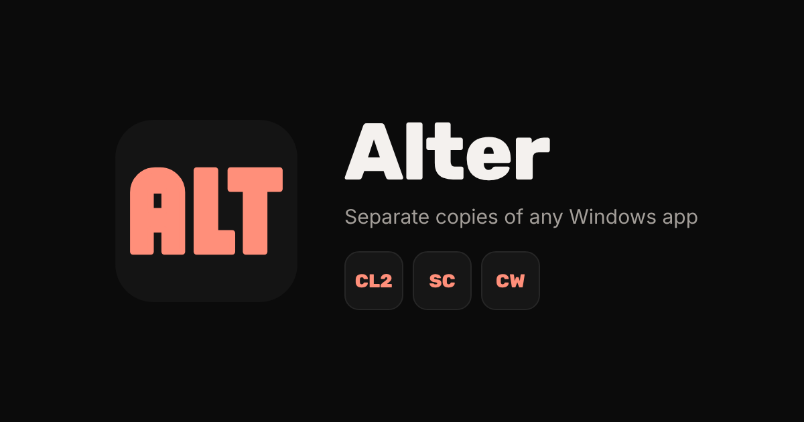

<p align="center">
  
</p>

# Alter

**Run separate copies of any Windows app, each with its own sign-in, settings, icon and taskbar button.**

A work Chrome next to a personal one. A second Claude desktop on another account. Two Discord accounts at once. Alter makes a copy of the app that behaves like its own app: its own data folder, its own shortcut, its own button on the taskbar.

- Free and open source
- Windows 10 and 11, and now [Linux](#linux) too
- Nothing to install: it runs on the PowerShell and .NET compiler that come with Windows

**[⬇ Download the latest release](https://github.com/ffrusdev/alter/releases/latest)** · [Website](https://ffrusdev.github.io/alter/)

---

## Contents

- [How to use it](#how-to-use-it)
  - [1. Download and open Alter](#1-download-and-open-alter)
  - [2. Make a copy of an app](#2-make-a-copy-of-an-app)
  - [3. Open your copy](#3-open-your-copy)
  - [4. Edit, stop or delete a copy](#4-edit-stop-or-delete-a-copy)
  - [Microsoft Store apps (like Claude)](#microsoft-store-apps-like-claude)
  - [Command line](#command-line)
- [Linux](#linux)
- [Troubleshooting](#troubleshooting)
- [How it works](#how-it-works)
- [Limits](#limits)
- [Build from source](#build-from-source)
- [Credits and license](#credits-and-license)

---

## How to use it

### 1. Download and open Alter

1. Download **Alter.zip** from the [latest release](https://github.com/ffrusdev/alter/releases/latest).
2. Right-click the zip, choose **Extract All**, and put the **Alter** folder somewhere permanent, for example in Documents.
3. Open the folder and double-click **Alter.exe**.
4. The first time, Windows may show **"Windows protected your PC"**, because Alter isn't signed with a paid certificate. Click **More info**, then **Run anyway**.

After the first start, Alter is also in the **Start Menu**, and you can pin it to the taskbar.

> Keep `Alter.exe`, `Alter.ps1` and the `fonts` folder together. `Alter.exe` is a small launcher for `Alter.ps1`.

### 2. Make a copy of an app

1. Click **New copy**.
2. Next to **App (.exe)**, click **Browse** and pick the app you want a copy of, for example:
   - Chrome: `C:\Program Files\Google\Chrome\Application\chrome.exe`
   - VS Code: `C:\Users\<you>\AppData\Local\Programs\Microsoft VS Code\Code.exe`
3. Alter fills in a **Name** (like "Google Chrome 2") and picks the right **Isolation** mode for the app. Change the name if you like, for example to "Chrome Work".
4. Optional: pick an **Icon** (`.png` or `.ico`). Without one, the copy shows a letter tile like **CW** for "Chrome Work".
5. Under **Options**, choose whether the copy gets its own taskbar button, a Desktop shortcut and a Start Menu shortcut.
6. Click **Create copy**.

The copy starts fresh, as if the app had just been installed. Sign in once and it remembers you from then on.

### 3. Open your copy

Any of these works:

- In Alter, click **Launch** on the copy's card.
- Double-click its **Desktop shortcut**, or find it in the **Start Menu** under **Alter**.
- Right-click the shortcut and **Pin to taskbar**, like any other app.

While a copy is running, its card shows **Running**, and it has its own button on the taskbar, separate from the original app.

### 4. Edit, stop or delete a copy

Click the arrow on a copy's card to open its page:

- **Stop** closes the copy's windows, like clicking X. If the app keeps running in the system tray, Alter asks before forcing it to close.
- **Edit** changes how the copy starts (app, icon, isolation, arguments, options). Saving rebuilds its launcher.
- **Open folder** shows where the copy keeps its data.
- **Delete copy** removes the copy, its shortcuts and its data folder, including its sign-ins. The original app is never touched.

### Microsoft Store apps (like Claude)

Store apps live in `C:\Program Files\WindowsApps\...` and can't be started from there. Many register a **launch alias** instead, which Alter can use:

1. In **Browse**, paste this into the **File name** box and click **Open**:
   `%LOCALAPPDATA%\Microsoft\WindowsApps\claude-desktop.exe`
2. Alter fills in the name, the real app's icon and the isolation mode.

If you pick the real program inside `WindowsApps`, Alter switches to its launch alias by itself. Store apps without a launch alias aren't supported.

To see which launch aliases you have, run this in PowerShell:

```powershell
Get-ChildItem "$env:LOCALAPPDATA\Microsoft\WindowsApps" -Filter *.exe | Select-Object Name
```

### Command line

You can also make a copy without opening the window:

```powershell
powershell.exe -NoProfile -ExecutionPolicy Bypass -File .\Alter.ps1 -Name "Chrome Work" -Target "C:\Program Files\Google\Chrome\Application\chrome.exe"
```

Options: `-Icon <path to .png/.ico>`, `-Mode Auto|Chromium|Firefox|Redirect|None`, `-Arguments "<launch arguments>"`, `-NoDesktopShortcut`.

---

## Linux

Alter for Linux is a small command-line tool (one Python 3 script, no dependencies) that makes the same kind of copies: own data, own name and icon, own app-menu entry. Chromium-based apps also get their own dock button.

```bash
# from the latest release: alter-linux.tar.gz
tar xzf alter-linux.tar.gz && cd alter-linux && ./install.sh

alter apps chrome                              # find the app
alter new "Chrome Work" --app google-chrome    # make a copy (it appears in your app menu)
alter launch "Chrome Work"                     # or click it in the app menu
alter list                                     # see your copies and which are running
```

It handles Chrome, Chromium, Edge, Brave, Firefox, Electron apps (VS Code, Slack, Discord, Obsidian…), Flatpak apps and most other apps. Full guide: **[linux/README.md](linux/README.md)**.

---

## Troubleshooting

| Problem | What to do |
|---|---|
| "Windows protected your PC" | Click **More info**, then **Run anyway**. It appears because Alter isn't signed. |
| A new copy's launcher gets a SmartScreen or Defender prompt | Same reason: each copy's launcher is a new, unsigned `.exe` built on your PC. Allow it once. |
| The copy opens your normal app instead of a new window | The app has a hard single-instance lock. Try **Isolation: Redirect**, then **Save changes**. Some apps can't be made to run twice (see [Limits](#limits)). |
| Signing in to the copy logs in your normal app instead | Some apps sign in through your browser and hand the login back through a link that Windows sends to the normal app. Close the normal app while you sign in to the copy. |
| "Alter.ps1 is missing" | Keep `Alter.exe` in the same folder as `Alter.ps1` and the `fonts` folder. |
| Alter shows an error box | It includes the line where the error happened. Please [open an issue](https://github.com/ffrusdev/alter/issues) with a screenshot of it. |

To check your PC end to end (PowerShell, compiler, and a test copy of Chrome or Edge), run `Test-Alter.ps1`. It writes `Test-Alter.log`:

```powershell
powershell.exe -NoProfile -ExecutionPolicy Bypass -File .\Test-Alter.ps1
powershell.exe -NoProfile -ExecutionPolicy Bypass -File .\Test-Alter.ps1 -Cleanup
```

---

## How it works

For each copy, Alter creates a folder in `%LOCALAPPDATA%\ParallWin\<Name>\`:

| File | What it is |
|---|---|
| `<Name>.exe` | A tiny launcher, compiled on your PC with the copy's icon |
| `config.txt` | The app, arguments and environment variables. `{DATA}` means the data folder |
| `data\` | The copy's own profile and settings |

**Isolation modes** decide how the copy's data is kept apart:

- **Chromium**: Chrome, Edge, Brave and Electron apps (VS Code, Slack, Notion, Obsidian, Claude…). Starts the app with its own `--user-data-dir`, plus `--extensions-dir` for VS Code-style editors.
- **Firefox**: its own `-profile`, with `-no-remote`.
- **Redirect**: for other apps. Points `APPDATA` and `LOCALAPPDATA` at the copy's folder. Discord also gets `--multi-instance`.
- **None**: no data separation, only a separate launcher, icon and taskbar button.

**Own taskbar button**: while the app runs, its launcher stays open quietly in the background and gives the app's windows their own taskbar ID (AppUserModelID), so Windows shows them as a separate app.

**App updates**: apps that install into `app-1.2.3` folders and move on every update (Discord, Slack and others) are found again automatically.

---

## Limits

- Apps with a hard "only one copy" lock (some games, Spotify, many game launchers) still refuse to open twice.
- Copies are separate profiles, not a security sandbox: every copy can still see your files.
- Store apps work only if they have a launch alias.
- Windows 10 and 11 only.

---

## Build from source

Everything runs from source; only the small launcher is compiled.

| File | What it is |
|---|---|
| `Alter.ps1` | The app: the window (WPF), copy management, and the C# source of the per-copy launcher |
| `src/AlterLauncher.cs` | Source of `Alter.exe`, which starts `Alter.ps1` without a console window |
| `Start Alter.cmd` | Opens Alter without the exe |
| `Test-Alter.ps1` | End-to-end check of a PC |
| `fonts/` | Rubik, Inter and JetBrains Mono (SIL Open Font License) |
| `logo/` | The logo as SVG, PNG and ICO |
| `linux/` | Alter for Linux: the `alter` command, its installer and tests |
| `VERSION` | The current version. Changing it and pushing to `main` publishes a new release (see `.github/workflows/release.yml`) |

Build `Alter.exe` with the C# compiler that ships with Windows:

```powershell
& "$env:WINDIR\Microsoft.NET\Framework64\v4.0.30319\csc.exe" /target:winexe /win32icon:logo\alter.ico /out:Alter.exe src\AlterLauncher.cs
```

---

## Credits and license

- Made by [Nabil Luqman (frus)](https://ffrusdev.github.io/).
- Fonts: [Rubik](https://fonts.google.com/specimen/Rubik), [Inter](https://fonts.google.com/specimen/Inter) and [JetBrains Mono](https://fonts.google.com/specimen/JetBrains+Mono), under the SIL Open Font License 1.1.
- Alter is released under the [MIT License](LICENSE).
